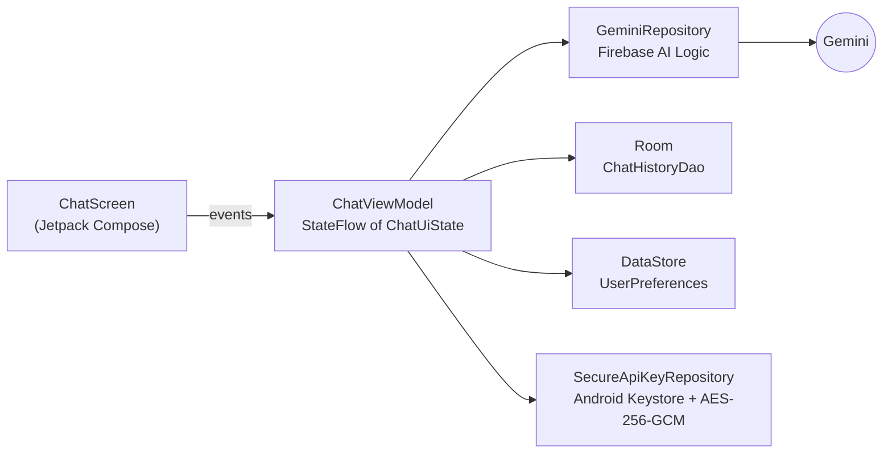

<div align="center">

# 💬 Gemini Chat for Android

### Google's Gemini in your pocket — speak or type, and it remembers the conversation

**A native Android chat app built with Kotlin and Jetpack Compose: Gemini answers through Firebase AI Logic,
voice input turns speech into prompts, chats are saved on the device, and any API key is locked away with
hardware-backed AES-256-GCM encryption.**


</div>

---

## Features

| | |
|---|---|
| 🤖 **Gemini answers** | Prompts go to Gemini through Firebase AI Logic (Google AI backend) |
| 🎙️ **Voice input** | Tap the mic and speak; Android speech recognition fills in the prompt |
| 💬 **Proper chat UI** | Material 3 bubbles, auto-scroll to the newest message, a loading indicator while Gemini thinks |
| 💾 **Remembers you** | Conversations stored on the device with **Room**; settings kept with **Preferences DataStore** |
| 🔐 **Secrets done right** | API keys encrypted with **AES-256-GCM** using a key that lives in the **Android Keystore** |
| 🌙 **Dark mode + dynamic color** | Follows the system theme (Material You colors on Android 12+) and adapts to different screen sizes |
| ⚠️ **Friendly errors** | Network or model problems show up as a Snackbar, never a crash |

## Architecture



Single-activity **MVVM**: the screen only renders `ChatUiState` and sends events; `ChatViewModel` owns the logic with
Kotlin coroutines and `StateFlow`; repositories hide where data comes from — which is what makes it testable.

## Tested

- **ViewModel tests** (`ChatViewModelTest`) run against a **fake Gemini repository**, so they are fast and need no network.
- **Compose UI tests** (`ChatScreenTest`) check the chat screen renders and reacts to input.

```bash
./gradlew test                    # unit tests
./gradlew connectedAndroidTest    # UI tests on a device or emulator
```

## Run it

1. Open the project in **Android Studio** and let Gradle sync.
2. Use your own Firebase project: create one, enable **Firebase AI Logic** (Gemini API), add an Android app with the
   package `com.example.n075nishantassgn1`, and replace `app/google-services.json` with yours.
3. Copy `local.properties.example` to `local.properties` and point it at your Android SDK.
4. Run on an emulator or phone with **Android 8.0 (API 26)** or newer.

## Tech stack

Kotlin · Jetpack Compose · Material 3 · Firebase AI Logic (Gemini) · Room · Preferences DataStore ·
Android Keystore · Kotlin Coroutines · StateFlow · Lifecycle Compose · JUnit · Compose UI Testing · Gradle (Kotlin DSL)
